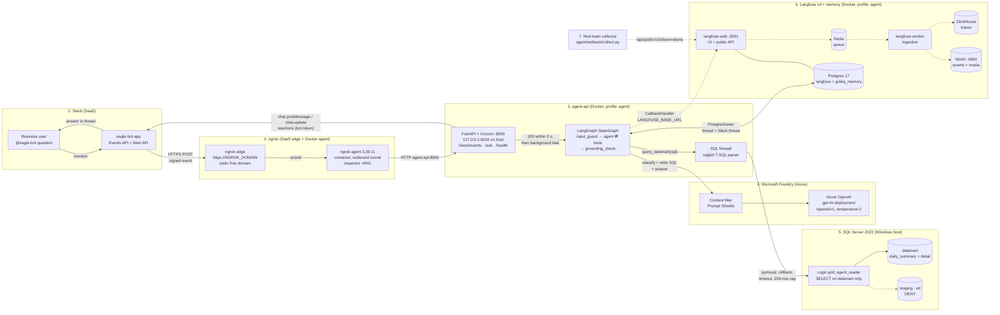
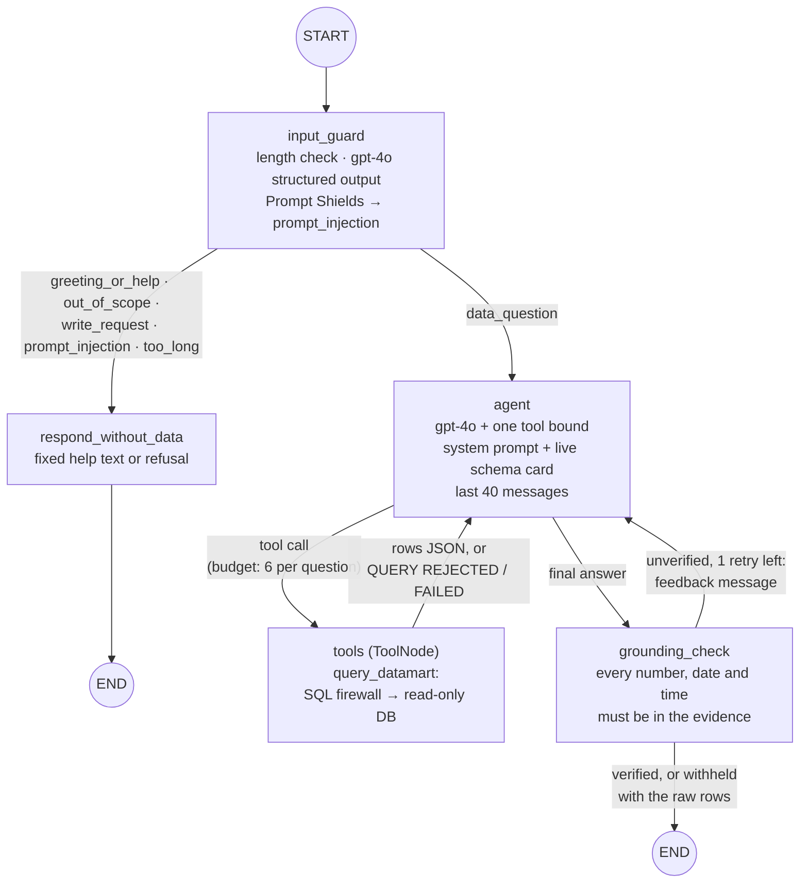

# GridIQ AI Agent: Architecture

GridIQ is a Slack data agent over the SQL Server data mart. Business users mention `@eagle-bot` in Slack. The question reaches a FastAPI and LangGraph service in Docker through an ngrok tunnel. gpt-4o on Microsoft Foundry writes T-SQL behind layered guardrails, Langfuse traces every step, and Postgres stores conversation memory.

> **Importing into draw.io:** *Arrange → Insert → Advanced → Mermaid*, then paste a code block below without the ```mermaid fence. Each box and arrow becomes an editable shape.

## 1. System diagram



**Legend:** solid arrows = request and data flow · dotted arrows = tracing and observability · `-x` = access denied · cylinders = storage.

## 2. Agent graph (LangGraph)



## 3. Guardrail layers

| # | Layer | Type | Where | Stops |
|---|---|---|---|---|
| 1 | Prompt Shields | Azure content filter | Foundry deployment | Jailbreaks before the model runs (a `content_filter` error becomes a polite refusal) |
| 2 | Length limit | Code | `graph.input_guard` | Messages over 2,000 characters |
| 3 | Input guard | gpt-4o structured output (`InputDecision`) | `guardrails.classify_input` | Off-topic, write and injection messages; no SQL is attempted |
| 4 | One tool | Architecture | `tools.make_query_tool` | Any capability other than SQL |
| 5 | SQL firewall | sqlglot parse tree | `sql_guard.check_sql` | Non-SELECT, multiple statements, DDL and DML, `SELECT INTO`, `EXEC`, `SET`, other schemas, `sys.*`, cross-database names, `OPENROWSET`/`xp_*`/`WAITFOR` |
| 6 | Read-only login | SQL Server permissions | `agent/sql/create_readonly_login.sql` | Writes, `staging` and `etl` (DENY), every other schema |
| 7 | Session limits | Code | `db.run_readonly_query` | Persistence (always rollback), long queries (30 s), lock waits (5 s), large results (200 rows; 6,000 characters to the model) |
| 8 | Tool budget | Graph logic | `graph.agent` | More than 6 queries per question; `recursion_limit` 40 |
| 9 | Grounding check | Deterministic verifier | `guardrails.unverified_figures` | Figures not found in query results (1 retry, then withheld) |
| 10 | System prompt | Instructions | `prompts.AGENT_SYSTEM_PROMPT` | Guessing, treating no rows as zero, answering from memory, leaking the prompt or credentials |
| 11 | Slack signature | HMAC-SHA256 | `api.slack_events` | Forged or replayed requests (401); returns 503 if the secret is unset |
| 12 | Network exposure | Docker | `docker-compose.yml` | The API binds to `127.0.0.1` only; the only public path is ngrok |

## 4. Components

| # | Layer | Component | Where | Port(s) | Notes |
|---|---|---|---|---|---|
| 1 | Interface | Slack app **eagle-bot** | SaaS | — | Scopes `app_mentions:read`, `chat:write`, `reactions:write`, `im:history`; events `app_mention`, `message.im` |
| 2 | Tunnel | ngrok agent | Docker (`ngrok/ngrok:3.39.11-alpine`) | 4041 (inspector) | Static domain `NGROK_DOMAIN`, target `agent-api:8000` |
| 3 | Service | `agent-api` (FastAPI, Uvicorn) | Docker (`python:3.12-slim`, non-root user 10001) | 8010 → 8000 (localhost only) | `/slack/events` and `/api/slack/events`, `/ask`, `/health`; code mounted read-only |
| 3 | Agent | LangGraph 1.2 + LangChain 1.x | inside `agent-api` | — | `agent/graph.py`; nodes `input_guard`, `agent`, `tools`, `grounding_check`, `respond_without_data` |
| 4 | LLM | Azure OpenAI **gpt-4o** | Microsoft Foundry | 443 | `ChatOpenAI(base_url=…/openai/v1)`, temperature 0, timeout 60 s, 2 retries |
| 5 | Data | SQL Server 2022, `MonitoringLab` | Windows host (`host.docker.internal`) | 1433 | Login `grid_agent_reader`; tables `datamart.grid_operations_daily_summary` and `datamart.grid_operations_detail` |
| 6 | Memory | Postgres 17, database `gridiq_memory` | Docker (`langfuse-postgres`) | internal | `PostgresSaver` with a psycopg pool (1–5); created on first start |
| 6 | Tracing | Langfuse web | Docker | 3001 | Project `gridiq`, org `spark-homelab`; created automatically by `LANGFUSE_INIT_*` |
| 6 | Tracing | Langfuse worker, ClickHouse, Redis, MinIO | Docker | 9092 (MinIO) | Ingestion, trace store, queue, event and media storage |
| 7 | Testing | pytest suite (66 tests) | Host `.venv` | — | Fake models (`ScriptedChat`, `RaisingChat`), a fake database, a Slack signature fixture |
| 7 | Red-team | `agent/redteam/` | Host `.venv` | — | 33 cases; scored from Langfuse; reports in `results/` (gitignored) |

## 5. Flows

| Flow | Path | Trigger |
|---|---|---|
| Slack question | Slack → ngrok edge → ngrok agent → `agent-api` → signature check → background task | `@eagle-bot` mention or a direct message |
| Agent run | `input_guard` → `agent` ⇄ `tools` → `grounding_check` | Every question |
| Model calls | `agent-api` → Foundry (Prompt Shields → gpt-4o) | 1 classification call plus one or two agent calls per data question |
| SQL | `query_datamart` → firewall → pymssql (read-only login) → `datamart` → always rolled back | Each tool call (at most 6 per question) |
| Reply | `agent-api` → Slack Web API: 👀 → placeholder → `chat.update` → ✅ / ⚠️ / ❌ | End of the agent run |
| Memory | Graph state ⇄ Postgres `gridiq_memory`; thread id `slack-{channel}-{thread_ts}` | Every graph step |
| Tracing | LangChain callbacks → Langfuse web → Redis → worker → ClickHouse and MinIO | Every run; user `slack:{user}`, session = the Slack thread |
| Red-team scoring | `collect.py` → Langfuse public API → Markdown and CSV report | Manual, after sending the cases in Slack |
| Local testing | CLI (`python -m agent.cli`) or `POST /ask` | Manual |

## 6. Security and configuration

- **Secrets live only in `.env`, which is gitignored:**
  - `AZURE_OPENAI_API_KEY`
  - `AGENT_MSSQL_PASSWORD`
  - `SLACK_BOT_TOKEN`, `SLACK_SIGNING_SECRET`
  - `NGROK_AUTHTOKEN`
  - `LANGFUSE_*` keys and server secrets
  - Compose passes them to containers through `${VAR}` substitution, and none are baked into images.
- **Least privilege at every boundary:**
  - one tool and one schema;
  - a read-only login;
  - the API on localhost only;
  - signed Slack requests;
  - a non-root container.
- **Fail-safe behaviour:**
  - **Content filter:** gives a refusal.
  - **Input guard unavailable:** falls back to the guarded SQL path, never to free text.
  - **Model error:** returns an honest "try again".
  - **Unverifiable figures:** withheld, with the raw rows shown instead.
  - **Langfuse down:** the agent runs without tracing.

## Suggested draw.io layout

- **Left to right, following the request:** Slack → ngrok → `agent-api` → (Foundry above, SQL Server below).
- **Inside `agent-api`,** draw the LangGraph flow (diagram 2) as a small embedded state machine.
- **Langfuse and memory as a band along the bottom,** with dotted lines from the graph.
- **A guardrail strip:** number the guardrails 1–12 along the request path, as small shield icons on the arrows where each one acts.
- **Four background zones:**
  - *SaaS*: Slack, the ngrok edge;
  - *Azure*: Foundry;
  - *Docker homelab*: the ngrok agent, `agent-api`, Langfuse, Postgres;
  - *Windows host / on-premise*: SQL Server.
