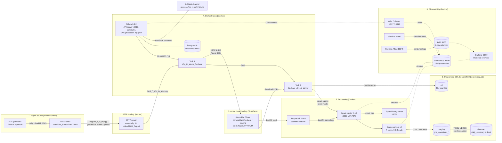

# Energy Intelligence Platform: Architecture

Hybrid data platform: open-source compute and orchestration in Docker, an Azure landing layer, an on-premise SQL Server data mart, Slack alerting and an observability stack.

> **Importing into draw.io:** *Arrange → Insert → Advanced → Mermaid*, then paste the code block below (without the ```mermaid fence). Each box and arrow becomes an editable shape.

## Diagram



**Legend:** solid arrows = data and control flow · dotted arrows = monitoring signals · cylinders = storage.

## Components

| # | Layer | Component | Where | Port(s) | Notes |
|---|---|---|---|---|---|
| 1 | Source | PDF generator (`pdf_generator/`) | Windows host / Jupyter | — | Faker + reportlab; deterministic seeds |
| 2 | Landing | SFTP server | Docker | 22 | `atmoz/sftp:alpine`, host keys in a volume |
| 3 | Cloud landing | Azure File Share `landing` | Azure, UK South, `rg-datalake-test-uksouth` | 443 (HTTPS) | StorageV2, LRS, Transaction optimized; Terraform in `infra/azure-landing/` |
| 4 | Orchestration | Airflow 3.3.2 (LocalExecutor) | Docker | 8088 | DAG `grid_report_daily`; Postgres 16 metadata DB |
| 5 | Processing | Spark 4.1.3 master, 2 workers, history server | Docker | 8080, 7077, 8081/8082, 18080 | Delta 4.4.0, Python 3.12, SQL Server JDBC driver built in |
| 5 | Processing | JupyterLab | Docker | 8888, 4040 | Backfill notebook `01_backfill_grid_report_to_sqlserver.ipynb` |
| 6 | Destination | SQL Server 2022 Developer | On-premise (Windows host) | 1433 | Database `MonitoringLab`: schemas `staging`, `datamart`, `etl` |
| 7 | Alerting | Slack | SaaS | — | Bot token; `@slack_notifications` decorator in `dags/common/` |
| 8 | Observability | Prometheus | Docker | 9090 | 15-day retention |
| 8 | Observability | Grafana | Docker | 3000 | "Homelab overview" dashboard, 24 panels |
| 8 | Observability | Loki | Docker | 3100 | 7-day retention |
| 8 | Observability | Grafana Alloy | Docker | 12345 | Ships Docker container logs to Loki |
| 8 | Observability | OpenTelemetry Collector | Docker | 4317, 4318 | Airflow metrics in, Prometheus exporter on 8889 |
| 8 | Observability | cAdvisor | Docker | 8090 | Container CPU, memory, network |

## Flows

| Flow | Path | Trigger |
|---|---|---|
| Report delivery | Generator → local folder → SFTP | Manual / upstream (`migrate_daily_grid_report_to_sftp.py`) |
| Cloud landing | SFTP → Azure File Share | Airflow task 1 at 06:00 UTC (T-1) |
| Daily ETL | Azure File Share → Spark → `staging` → `MERGE` → `datamart`, plus `etl.file_load_log` | Airflow task 2, after task 1 |
| Backfill | Azure File Share → Jupyter + Spark → `staging` → `MERGE` → `datamart` | Manual, from the notebook |
| Alerting | Airflow → Slack | Every DAG run (success) and every failed task (after 2 retries) |
| Metrics | Spark, Airflow (via OTel Collector), cAdvisor → Prometheus → Grafana | Continuous, every 15 s |
| Logs | All containers → Alloy → Loki → Grafana | Continuous |

## Suggested draw.io layout

- **Left to right, following the data:** Source → SFTP → Azure → Airflow and Spark → SQL Server.
- **Observability as a band along the bottom,** with dotted lines up to the components it watches.
- **Slack** in the top-right corner, fed by Airflow.
- **Three background zones** for where things run: *Windows host / on-premise* (generator, SQL Server), *Docker homelab* (SFTP, Airflow, Spark, Jupyter, observability), and *Azure* (File Share).
